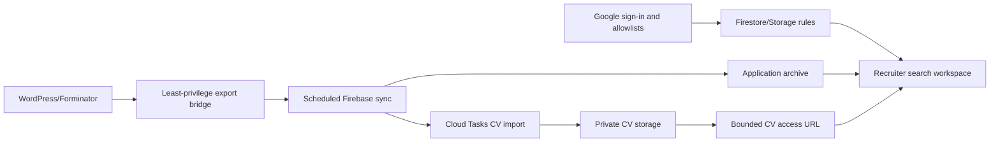

# Apex Application Archive: Engineering Overview

Apex Application Archive is a security-focused recruiter workspace that reconciles historical applications from WordPress into Firebase without losing source fidelity or allowing recruiter edits to overwrite ingestion truth.

## At a glance

| Area | Implementation |
| --- | --- |
| Core stack | React, TypeScript, Vite, Firebase Auth, Firestore, Storage, Functions, Cloud Tasks |
| Ingestion | Least-privilege WordPress bridge, scheduled reconciliation, source hashing, leases, retries |
| Security | Deny-by-default rules, recruiter allowlists, URL/file validation, private CV storage, bounded access URLs |
| Product | Search-first application archive, filters, monitoring, CSV export, CV preview/download |
| Verification | PHP normalization test, 26 root tests, 7 Functions tests, 8 emulator rule tests, typechecks and builds |

## Why this project is technically interesting

- **Historical records are append-oriented.** Each application remains a distinct event while recruiter-owned state is isolated from source-controlled fields.
- **File ingestion is adversarial by default.** Host, path, extension, size, and file signature checks precede private Storage writes.
- **Rules are tested as product code.** Firestore and Storage permissions are exercised against emulators, including signed CV-access behavior.
- **Synchronization is recoverable.** Leases, source hashes, retries, deletion-state retention, and dry-run paths make background reconciliation operationally inspectable.

## System shape

## Guided code tour

1. **`wordpress-plugin/`** — Forminator export bridge and normalization tests.
2. **`functions/src/sync.ts`** — reconciliation, leases, source truth, and scheduled ingestion.
3. **`functions/src/cv*.ts`** — CV validation, import, and bounded access behavior.
4. **`firestore.rules` and `storage.rules`** — deny-by-default data and file authorization.
5. **`src/services/archive.ts`** — typed frontend access to archive workflows.
6. **`src/App.tsx`** — search-first recruiter interface and operational status.
7. **`tests/` and Functions tests** — emulator, normalization, and regression coverage.

## Verification

The current release passes the canonical `npm run verify` path after installing both locked workspaces:

- WordPress normalization: pass;
- root Vitest: 26 tests;
- Functions Vitest: 7 tests;
- Firestore/Storage emulator rules: 8 tests;
- frontend and Functions typechecks: pass;
- frontend and Functions builds: pass.

## For coding agents

1. Preserve the division between source-owned and recruiter-owned fields.
2. Keep CVs private and require validated, bounded access.
3. Treat rules, Functions, and the WordPress bridge as one end-to-end security boundary.
4. Never commit applicant data, local environment files, service-account material, or emulator state.
5. Run both workspace installs before `npm run verify`.

## Current boundaries

- The repository contains application code, rules, and fictional development previews—not production applicant records.
- AI search, CV text extraction, semantic ranking, and automated hiring recommendations remain outside V1.
- External WordPress, Firebase, and scheduled-sync behavior requires live environment verification beyond emulator tests.

## What this repository demonstrates

Apex Application Archive demonstrates production-minded full-stack engineering: secure ingestion, resilient synchronization, private document handling, rules-as-code, human-owned workflow state, and strong end-to-end verification.
